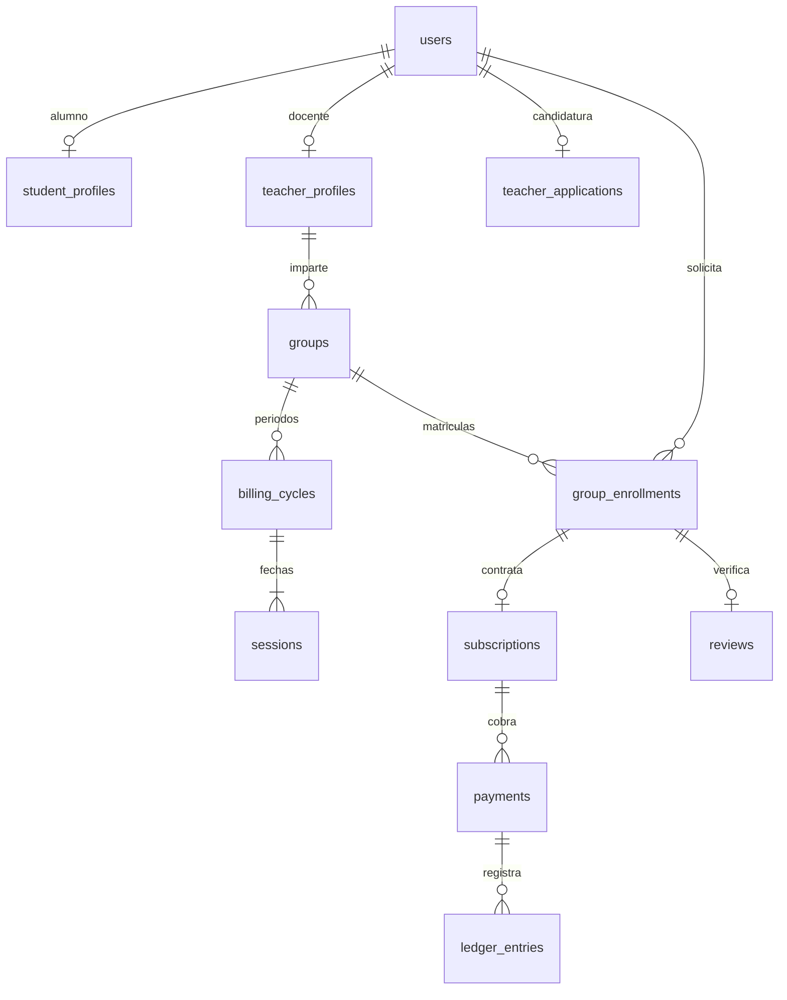

# Datos y migraciones

`migrations/001_initial.sql` crea el esquema PostgreSQL. `scripts/migrate.ts` aplica archivos ordenados en una transacción y registra sus nombres; bloqueo asesor evita dos migradores simultáneos. Los archivos aplicados no se editan en producción: añadir una nueva migración.

`002_lichess_identity.sql` incorpora identificador Lichess único, alias separado, nombre real y fecha de perfil completo. El email pasa a ser opcional y deja de ser una credencial. Revoca sesiones y tokens heredados y elimina sus hashes de contraseña. No enlaza cuentas anteriores por coincidencia de correo.

## Relaciones principales

Identidad: `users`, perfiles, `auth_sessions`, `auth_tokens`, `rate_limits`.

Docentes: candidaturas, referencias, estados, disponibilidad, vacaciones, niveles/historial de comisiones y bajas. La mera existencia de una tabla no implica que su flujo avanzado ya esté desarrollado.

Academia: grupos, matrículas, ciclos, sesiones, asistencia y reservas de horario. `student_slots` usa intervalos semiabiertos `[inicio,fin)`: las clases consecutivas son válidas.

Economía: planes, suscripciones, pagos, devoluciones, liquidaciones y ledger. Importes en céntimos EUR, porcentajes en puntos básicos (5000=50 %). Restricciones únicas para factura Stripe, evento, transferencia y clave de movimiento.

Gestión: reseñas y moderación, bajas del alumno, campañas y atribución, notificaciones, outbox, incidencias, auditoría y configuración.

## Restricciones importantes

- Email normalizado y único; una matrícula por alumno/grupo y una reseña por matrícula.
- Restricciones de aforo configurado, mínimo y duración; validación de aforo ocupado en la transacción.
- Exclusión de solapamientos por profesor y alumno en PostgreSQL con `btree_gist`.
- Ledger y auditoría protegidos contra UPDATE/DELETE. Corregir mediante movimientos compensatorios.
- Snapshot de importe, porcentaje y ciclo profesional del pago inmutable.
- Liquidaciones cerradas no editables.

## Evolución y restauración

Usar migraciones compatibles con la aplicación desplegada; cambios destructivos requieren plan separado, copia y ventana de mantenimiento. Guardar backups cifrados y WAL/PITR del proveedor fuera del servidor de la aplicación. Probar restauración en una base aislada antes del lanzamiento y periódicamente después. No basta con que el proveedor diga que hace backups.

El esquema inicial contiene estructuras para fases futuras (liquidaciones, referencias, vacaciones) que todavía no tienen todos sus flujos de interfaz. No insertar métricas, reseñas ni usuarios ficticios en la base de producción. Los ejemplos del catálogo están separados del almacenamiento real.
